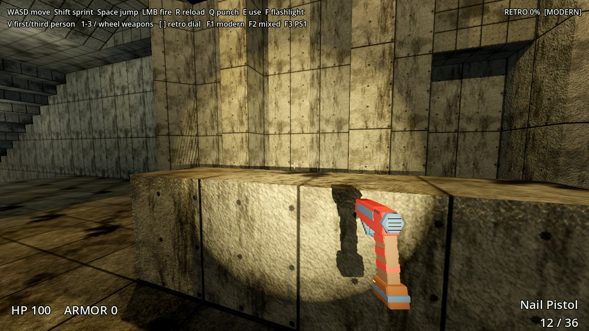
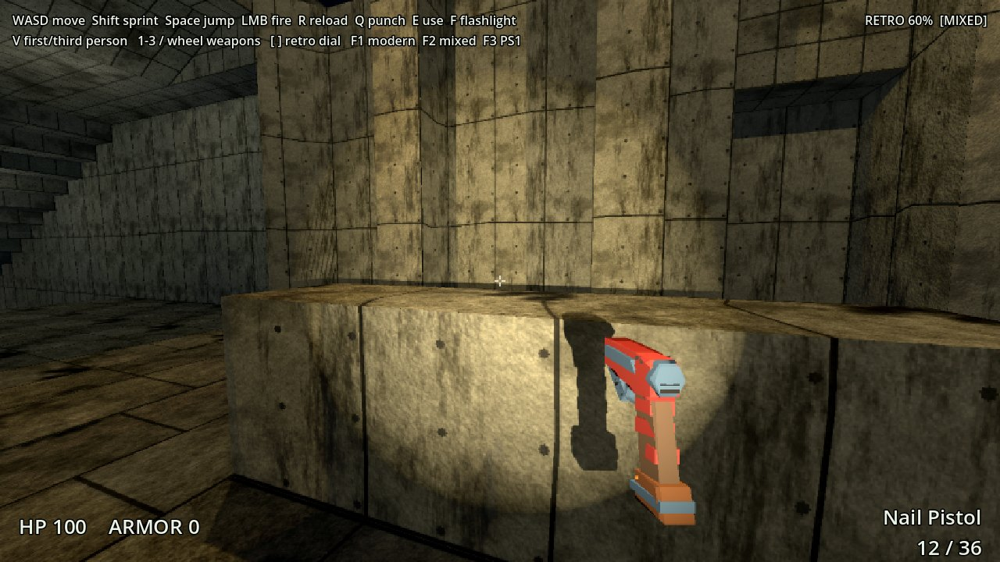
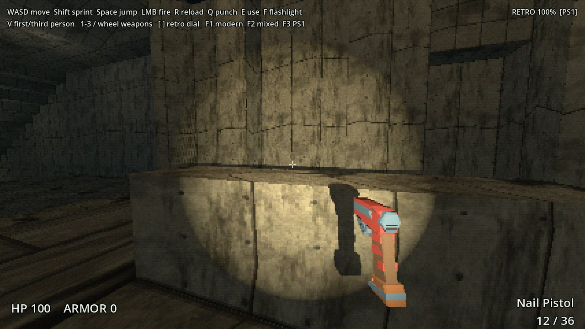
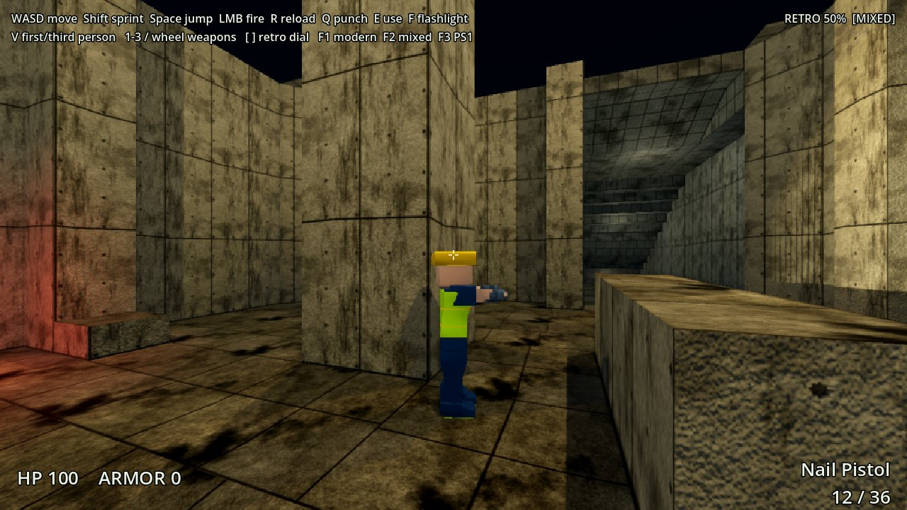
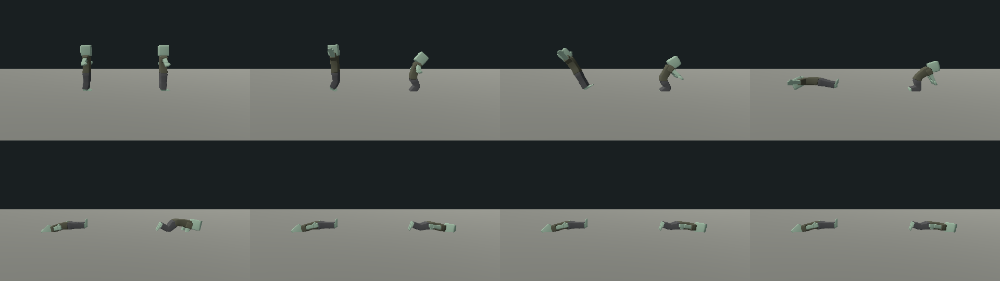

# Site-19 Oregon (working title)

*Bad Ideas Works: a regular guy, a secret complex under an Oregon forest, and a lot of keycards.*

A survival-action-horror vertical slice in **Godot 4.7**, built entirely from our own generators:

| Piece | From |
|---|---|
| The facility (rooms, stairs, keycard doors, secret door, exit, lights, enemy spawns) | **BadLevel**, `facility` recipe |
| Dale (player), zombies | **BadCharacters** (blocky style, worker / zombie themes) |
| Pistol, shotgun, SMG (with Fire / Reload clips) | **BadGun** |

| Modern | Mixed | PS1 |
|---|---|---|
|  |  |  |

## Textures and animation

**Level textures** are procedural 2 m tiles (`tools/gen_textures.py`, seeded): slabbed concrete floors,
panelled and grimy walls, acoustic ceiling tiles, red and blue blast doors, a secret door that is almost a
wall, diamond-plate lifts. Each has a normal map that fades out as the retro dial goes up, and the PS1 look
samples a coarser mip with nearest filtering. BadLevel tags every room with a facility *sector*; each sector
gets its own colour identity (admin beige, research teal, reactor rust).



**Death** is built in the same layer (BadCharacters ships no death clip): the body pivots around the feet with a
gravity-style ease-in, limbs react, it lands with a bounce and a thud. Shot from the front, a zombie topples
backwards; from behind, its knees give way and it face-plants. Dale goes down the same way, in third person,
before the "YOU DIED" banner. `tools/death_stage.tscn` renders this filmstrip (fixed timestep, repeatable).



**Animation.** BadCharacters ships 7 baked clips (Idle, Walk, Run, Jump, Wave, Punch, RestPose); we use
them all but RestPose: Idle/Walk/Run/Jump for movement, **Punch** for the player's melee (`Q`) and the
zombies' attack, **Wave** when you reach the exit. What the generator doesn't ship is layered on top by
`scripts/pose_layer.gd` (a SkeletonModifier3D): a gun-aim pose that follows camera pitch, a zombie shamble
(arms out, head hung, hunched), hit flinches and death. New clips (crouch, reload poses) belong in
BadCharacters itself; this layer is the stopgap.

## The retro dial

One number, `Retro.level` (0 = modern, 1 = full PS1), drives the whole look at once:

| Layer | Fades in with retro | Fades out with retro |
|---|---|---|
| Surface shader (`shaders/retro_surface.gdshader`) | vertex snapping, affine texture warp, nearest texels, banded colour | smooth perspective-correct filtering |
| Post pass (`shaders/retro_post.gdshader`) | low virtual resolution, ordered (Bayer) dither, colour banding | exact pass-through at 0 |
| Environment (`scripts/retro.gd`) | short thick fog | SSAO, SSIL, glow, volumetric fog, filmic tonemap |
| Lights | | soft shadows (off above 65 %) |

Lighting stays Godot's PBR the whole way, so "mixed" is a modern game run through a 1997 console.
The static level snaps gently (big polygons crack at T-junctions if snapped hard); characters and
guns get the full wobble.

## Run it

Needs Godot 4.7+. Open the folder in the editor and press play, or:

```bash
godot --path .
```

### Controls

| | |
|---|---|
| Move / sprint / jump | `WASD` / `Shift` / `Space` |
| Fire / reload / punch | left mouse / `R` / `Q` |
| Use (doors) | `E` |
| Flashlight | `F` |
| First / third person | `V` |
| Weapons | `1` `2` `3`, mouse wheel |
| Retro dial | `[` `]` step, `F1` modern, `F2` mixed, `F3` PS1 |
| Release mouse | `Esc` (click to recapture) |

### The game

You start in the surface lobby and work down. Two locked doors (red, blue) gate the facility; find
the matching keycards (they're coloured floating bricks), grab the shotgun in the lobby, mind your
ammo, and reach the exit. Zombies hear you (sprinting is loud, shooting is louder) and see you;
they follow a baked navmesh and head straight for you once they have a clear line. Kills sometimes
drop ammo or health. A secret door hides something nice.

### Command line (after `--`)

```
--retro=0.6   start dial        --tpp   third person      --god   invulnerable
--shot=out.png --frames=40      screenshot and quit (use --rendering-method gl_compatibility if no Vulkan)
--at=x,y,z,yawdeg,pitchdeg      teleport the player
--level=res://assets/level/other.glb
--selftest                      headless gameplay test (see below)
```

## Windows exe

`export_presets.cfg` has a "Windows Desktop" preset (single exe, data embedded). With the export
templates installed (Editor > Manage Export Templates):

```bash
godot --headless --path . --export-release "Windows Desktop" build/Site19Oregon.exe
```

## New facility, new guns

`tools/regen_assets.sh [seed]` rebuilds the level, guns and characters from checkouts of the three
generators (see the header of the script). Every seed is a different facility; the game reads
everything (spawns, doors, keys, lights, exit) from the GLB's entity nodes, so nothing else changes.

## Tests

```bash
godot --headless --path . -- --selftest
```

27 checks against the real game: player settles on the floor, 44 zombies spawn, navmesh bakes and
paths zombie to player, the crosshair hits a zombie and damages it, ammo is spent, a zombie wakes,
chases and hurts the player, chasing zombies and the aiming player hold their hands out in front
(measured on the skeleton), the punch plays its clip and hurts, a locked door refuses then opens with
the key, pickups collect (health, weapon, ammo via the trigger area), reaching the exit wins, and
both zombie and player really go down (head height measured after the fall).

## Layout

```
scripts/retro.gd        the dial + material converter (StandardMaterial3D -> retro shader)
scripts/level.gd        GLB -> playable level (collision, navmesh, entities)
scripts/player.gd       FPP/TPP, weapons, flashlight, interaction
scripts/enemy.gd        zombie AI
scripts/door.gd         locked / secret doors     scripts/pickup.gd   health, ammo, keys, guns
scripts/hud.gd          text HUD                  scripts/sfx.gd      procedural sounds (no audio assets)
scripts/pose_layer.gd   aim / shamble / flinch layers on the baked clips
scripts/world_textures.gd  texture set for the level materials
scripts/step_helper.gd  step-up for BadLevel's 0.5 m stairs
tools/                  asset regen, texture generator, GLB inspection helpers
```

## Honest status

* **Tested here** under Godot 4.7.2 with the Compatibility renderer (software OpenGL) and headless
  physics. **Not yet seen in Forward+** (no Vulkan driver in the build container), so SSAO, SSIL,
  glow and volumetric fog are set but unverified. If Forward+ misbehaves, try
  `godot --path . --rendering-method gl_compatibility` and tell us what you see.
* One level, one enemy type, three guns. No crouch clip yet (see above). No saving, no menu, no music; sounds are synthesized.
* Zombies are simple: they cannot open doors, and closed doors cut the navmesh (it isn't rebaked).
* Lifts and ladders in other seeds are static geometry; this seed has none that matter.
* Balance is a first guess.

*Studio motto #001: "Code shall remain understandable to whichever AI inherits this mess."*
